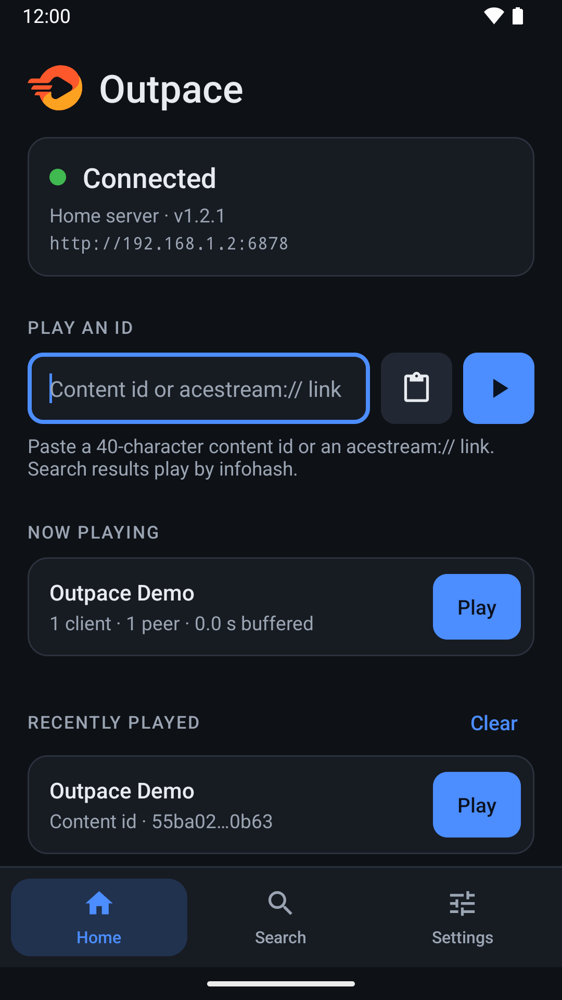
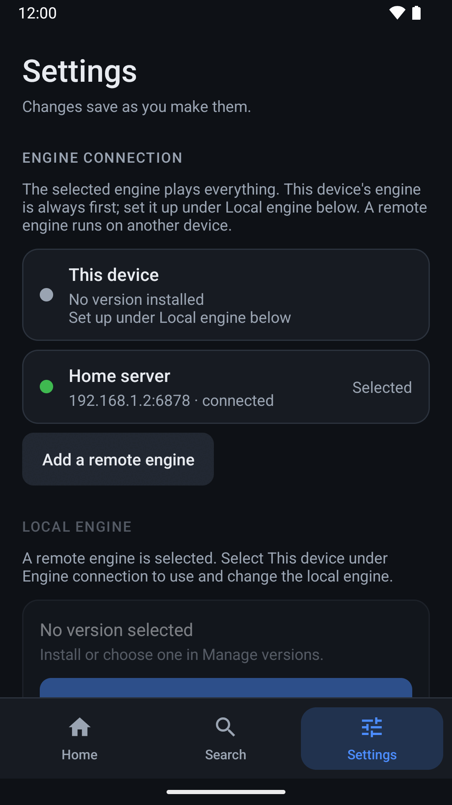
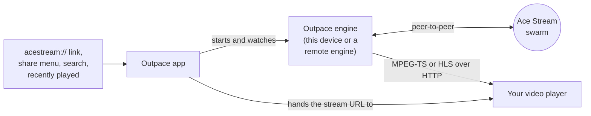

<p align="center">
  
</p>

<h1 align="center">Outpace for Android</h1>

<p align="center">
  <a href="https://github.com/outpace-stream/outpace-android/releases/latest"></a>
  <a href="https://github.com/outpace-stream/outpace-android/actions/workflows/ci.yml"></a>
  <a href="LICENSE"></a>
  
  
</p>

<p align="center">
  <b>Watch Ace Stream content on your phone or TV, with the open-source Outpace engine.</b><br>
  The app runs the <a href="https://github.com/outpace-stream/outpace-engine">Outpace engine</a> in the background with no root and no Termux,
  or connects to one on your home server, and opens streams in the player you already use.
</p>

<p align="center">
  <a href="https://github.com/outpace-stream/outpace-android/releases/latest"><b>Download the APK</b></a> ·
  <a href="docs/Android-App.md">User guide</a> ·
  <a href="https://github.com/outpace-stream/outpace-engine/wiki/Android-TV">Android TV setup</a> ·
  <a href="https://github.com/outpace-stream/outpace-engine/wiki">Engine docs</a> ·
  <a href="https://github.com/outpace-stream/outpace-android/issues">Report a problem</a>
</p>

<p align="center">
  
  &nbsp;&nbsp;
  
</p>

## What it does

Outpace for Android turns a content id or an `acestream://` link into playback in VLC, MX
Player, Just Player, Kodi or any other video player. It has no player of its own and contains
no engine: on first start you pick an Outpace engine release, the app downloads and verifies it,
and runs it for you.



## Features

- **Runs the engine for you.** Pick a release on **Engine versions**: the app downloads it from
  [engine releases](https://github.com/outpace-stream/outpace-engine/releases), checks its
  SHA-256, keeps up to three versions side by side, and runs the one you select from a
  foreground service. It tells you when a newer engine exists and never upgrades on its own.
- **Or use an engine you already run.** Add a remote engine by address (a home server, NAS or TV
  box, plain HTTP or behind an HTTPS proxy). Home, Search and playback then use that engine, and
  video goes straight from it to your player.
- **Plays from wherever you find a stream.** Tap an `acestream://` link, share one to Outpace,
  paste an id, replay from **Recently played**, rejoin from **Now playing**, or let apps that
  open `http://localhost:6878/ace/getstream?id=…` hand their streams to it. On Android 12 and
  newer, the same link with `127.0.0.1` may open in a browser or player instead of offering
  Outpace; see the [user guide](docs/Android-App.md#playing-a-stream).
- **Shows how a start is going.** "Looking up the stream", "Finding peers (3)", "Buffering",
  then a clear reason if it fails, such as no peers or protected content.
- **Search by name.** Optional [stream search](https://github.com/outpace-stream/outpace-engine/wiki/Stream-Search)
  with results grouped by channel. Off until you turn it on.
- **Play on TV.** Send a live stream to a DLNA/UPnP smart TV or receiver with no app on the TV
  (engine v1.2.0 or newer).
- **Built for the couch, too.** Every screen works with a D-pad. On TVs, tablets and landscape
  phones the tabs become a side rail, and the app can start the engine when the TV boots.
- **Network options when you need them.** A SOCKS5 proxy for networks that block peer-to-peer,
  LAN access for other devices, seeding and upload limits, router port mapping, a low-memory
  mode and [engine camouflage](https://github.com/outpace-stream/outpace-engine/wiki/Engine-Camouflage).
- **Easy on the battery.** Peer and buffer details are fetched only while a screen is open; in the
  background the app checks the engine every 30 seconds, holds a wake lock only while a stream is active, and can stop an idle
  engine after 10 minutes.
- **Keeps itself up to date.** At most once a day it checks for a newer app release, shows the
  release notes, and updates after you confirm, with the APK checked against its `.sha256`.
- **Small and dependency-free.** An APK under 2 MB, built on the platform SDK alone, with no
  analytics or trackers. Available in English, Spanish, Portuguese, French, Italian and German.

## Requirements

| | |
| --- | --- |
| Android | 5.0 (Lollipop) or newer, phones, tablets, Android TV and Google TV |
| Processor | 64-bit ARM (`arm64-v8a`), 32-bit ARM (`armeabi-v7a`) or x86_64 (emulators, ChromeOS, Intel and AMD TV boxes). Many TV boxes run 32-bit Android on a 64-bit chip; the app picks the matching engine build. 32-bit x86 is not supported. |
| Engine | Outpace v1.0.0 or newer on 64-bit ARM, v1.0.2 or newer on 32-bit ARM, v1.2.1 or newer on x86_64. Search, Play on TV, the proxy and camouflage need newer engines; the app shows each setting only when the selected engine supports it. |
| Player | Any video player app, for example VLC. |

## Install

1. Download `outpace-android-<version>.apk` and `outpace-android-<version>.apk.sha256` from the
   [latest release](https://github.com/outpace-stream/outpace-android/releases/latest).
2. Check the download (optional, recommended):

   ```bash
   sha256sum -c outpace-android-<version>.apk.sha256
   ```

3. Open the APK on your device and allow installing from that source when Android asks.

On a television, install from a computer with `adb`. The
[Android TV guide](https://github.com/outpace-stream/outpace-engine/wiki/Android-TV) walks
through developer options, authorising the computer and installing, step by step.

The app is not on the Play Store, because Play policy doesn't allow apps that download programs
to run. Once installed, it updates itself from this repository's releases.

## Quick start

1. Open Outpace. Home says **Local engine not set up**; press **Configure**.
2. Under **Local engine**, choose **Manage versions**, then **Install** on the newest release.
3. Press **Start engine**. The status turns green and shows the engine version.
4. Paste a content id or tap an `acestream://` link, then pick your player. The first start of a
   stream usually takes 20 to 60 seconds while the engine finds peers and buffers.

Already running Outpace on another machine? Skip steps 2 and 3: in **Settings > Engine
connection** choose **Add a remote engine** and enter its address, such as `192.168.1.20:6878`.
That engine must listen on the network (`OUTPACE_BIND=0.0.0.0:6878`). Add
`OUTPACE_ACE_COMPAT=true` if you want the app to show its version.

## Good to know

- **Only public, unencrypted content plays.** Premium and encrypted streams are out of scope for
  Outpace.
- **Your player does the playing.** If no player appears in the chooser, install one, or use
  **Copy URL** and paste the address into a player that takes network streams.
- **The engine API has no password.** It stays on `127.0.0.1` unless you turn on **Allow LAN
  access**. Turn that on only on a network you trust.
- **Search and camouflage contact third parties.** Search sends your query and IP address to
  Ace Stream's public index over plain HTTP. Both are off until you turn them on.
- **The engine shows up as `linker`** in process lists on Android 10 and newer. That is how
  Android lets apps run a downloaded program, and it is expected.
- **Streams stop with the screen off?** Allow Outpace to ignore battery optimisation; the app
  offers this on TVs and when start on boot is on.

The [user guide](docs/Android-App.md) covers every screen, setting and message. For engine
behaviour, such as slow starts, peers and ports, see the
[engine troubleshooting page](https://github.com/outpace-stream/outpace-engine/wiki/Troubleshooting).

## Privacy

The app has no accounts, analytics or ads. It talks to GitHub to check for and download app and
engine releases, to the engine you select, and to nothing else on its own. The engine joins
public peer-to-peer swarms, so peers see your IP address, as with any BitTorrent-style client.

## Versions

App versions are independent of engine versions. App releases are on the
[releases page](https://github.com/outpace-stream/outpace-android/releases); 1.0.0 is the first
stable release, and the earlier 0.x builds were previews. Engine releases are chosen inside the
app and come from the
[engine repository](https://github.com/outpace-stream/outpace-engine/releases).

## Building from source

Use JDK 21 and Android SDK 36:

```bash
./gradlew --no-daemon testDebugUnitTest lintDebug assembleRelease
```

`-PappVersion=X.Y.Z` sets the app version (version code `major*1_000_000 + minor*1_000 +
patch`); without it, builds are version `0.0.0` and never offer updates. A build you sign
yourself can't update over the official release, and the other way round, because Android
checks the signing key.

Release builds are signed only in CI. Pushing a `vX.Y.Z` tag runs
[`release.yml`](.github/workflows/release.yml), which builds, signs and publishes
`outpace-android-X.Y.Z.apk` with its `.sha256`. Signing reads `OUTPACE_ANDROID_KEYSTORE`
(keystore path), `OUTPACE_ANDROID_KEYSTORE_PASSWORD`, `OUTPACE_ANDROID_KEY_ALIAS` and
`OUTPACE_ANDROID_KEY_PASSWORD`; in CI the keystore comes from the
`OUTPACE_ANDROID_KEYSTORE_BASE64` secret. Never commit a keystore or secret.

The application ID is `io.github.outpacestream.android`. Contributor guidelines, the engine
boundary and launch rules are in [AGENTS.md](AGENTS.md); the scope contract is the
[design document](docs/android-app-design.md).

### Icons

The launcher icon, themed icon, notification icon, in-app logo and TV banner are generated in
[outpace-stream/assets](https://github.com/outpace-stream/assets) from the canonical logo SVG.
Regenerate them there and copy its `android/res` into `app/src/main/res`; do not hand-edit them.

## Related projects

- [outpace-engine](https://github.com/outpace-stream/outpace-engine): the engine itself, for
  Linux, macOS, Windows, FreeBSD, Docker and Android.
- [Engine wiki](https://github.com/outpace-stream/outpace-engine/wiki): installation,
  configuration, playback and troubleshooting.

## License

Outpace for Android is licensed under the [GNU AGPL v3.0](LICENSE). It is an independent
project, not affiliated with or endorsed by Ace Stream; Ace Stream names are used only to
describe compatibility. **Settings > About > Open-source licenses** lists the bundled components
and their licenses.
